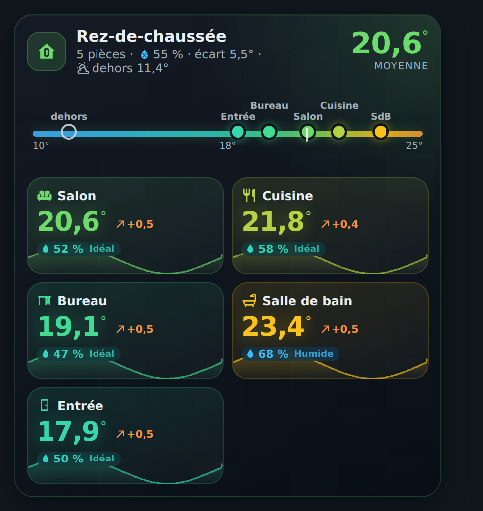
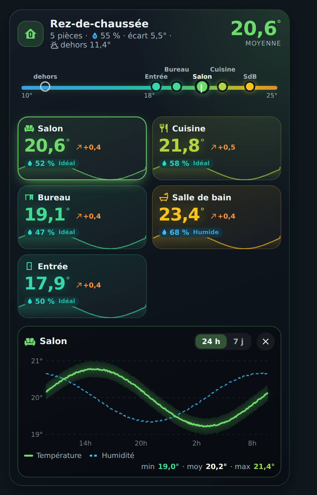

# 🏠 HOLM Floor Card

[](https://hacs.xyz/)


[🇫🇷 Français](README.md) · 🇬🇧 English

**Every temperature on a floor at a glance: where it's too hot, too cold, too humid, and how it's changing.**

HOLM Floor Card gathers a floor's temperature (and humidity) sensors in one colourful card: a **heat strip** places each room on a colour scale, and each room has its tile with its **1 h trend** and **24 h mini chart**. Tap a room to open its **detailed chart**.

> ✨ **Zero YAML, no helper.** Charts come straight from Home Assistant statistics. Everything is set in the visual editor.

### At a glance

- 🌡️ **Header**: floor average, average humidity, spread between the coldest and warmest room, outdoor temperature.
- 🌈 **Heat strip**: each room (and outside) placed on a colour scale, from blue to red.
- 🧱 **Room tiles**: coloured temperature, one-hour trend (↗ / ↘), humidity with its level (Dry, Ideal, Humid…), 24 h mini chart.
- 📈 **Detailed chart** on tap: temperature and humidity over **24 h or 7 days**, with min / average / max.
- 🔋 **Battery badge** (optional) on each tile: icon and colour by level, with your own thresholds.
- 🎨 **Light or dark look, or your theme's colours**.
- 👆 Long press on a room: entity dialog.
- 🌍 **8 languages**: English, French, German, Spanish, Italian, Dutch, Portuguese and Polish.

| Overview | Room chart |
|---|---|
|  |  |

*Screenshots in French — the card follows the language of your Home Assistant profile.*

### 🆕 What's new in 1.2.1

- 🔒 **Security**: room names and icons (and a name taken from an entity) are now escaped before being displayed. A name containing `<`, `"` or `&` is shown as is and can no longer break the card or run code.

### What's new in 1.2.0

- 🌍 **The card speaks 8 languages**: English, French, German, Spanish, Italian, Dutch, Portuguese and Polish, editor included. It follows the language of your Home Assistant profile (English if your language isn't translated yet); the `language` option lets you force one. Numbers and dates follow the language too.

---

## Installation

### With HACS (recommended)

1. Open **HACS** and search for **HOLM Floor Card**.
2. Open the card → **Download**.
3. Reload the page (Ctrl + F5).

> If the card does not show up in the search yet: HACS → ⋮ menu → **Custom repositories**, add `https://github.com/kaaribou/holm-floor-card`, category **Dashboard** (*Plugin*), then start again at step 1.

### Manually

1. Copy `dist/holm-floor-card.js` to `config/www/community/holm-floor-card/`.
2. **Settings → Dashboards → ⋮ → Resources → Add**: `/local/community/holm-floor-card/holm-floor-card.js`, type **JavaScript module**.
3. Reload the page.

---

## Usage

Add the **HOLM Floor** card, give it a title and add your rooms in the editor (**Add a room** button).

```yaml
type: custom:holm-floor-card
title: Ground floor
icon: mdi:home-floor-0
outdoor_entity: sensor.outdoor_temperature
rooms:
  - name: Living room
    icon: mdi:sofa
    temperature: sensor.living_room_temperature
    humidity: sensor.living_room_humidity
    battery: sensor.living_room_battery
  - name: Bathroom
    short: Bath
    temperature: sensor.bathroom_temperature
```

## Options

| Option | Description | Default |
|---|---|---|
| `language` | Language: `fr`, `en`, `de`, `es`, `it`, `nl`, `pt`, `pl` | the profile's |
| `title` / `icon` | Floor title and icon | `Floor` (in the card's language) / `mdi:home-floor-0` |
| `outdoor_entity` | Outdoor temperature (shown in the header and on the strip) | — |
| `hours` | Mini chart length (h) | `24` |
| `show_humidity` | Show humidity | `true` |
| `theme` | Look: `auto` (follows Home Assistant's light / dark mode), `dark`, `light`, `theme` (your theme's colours) | `auto` |
| `battery_display` | Battery badge: `always`, `low` (only when low), `never` | `always` |
| `battery_percent` | Show the percentage next to the icon | `false` |
| `battery_warn` | Orange threshold (%) | `30` |
| `battery_low` | Red threshold (%) | `15` |
| `rooms` | Rooms: `name`, `icon`, `temperature` (**required**), `humidity`, `battery`, `short` (short name on the strip) | — |

### Battery badge

Add the room sensor's battery entity (`battery`): a % sensor (`sensor`, class `battery`) or a “low battery” sensor (`binary_sensor`, class `battery`).

| Level | Icon | Colour |
|---|---|---|
| above the orange threshold | 🔋 by level (full, 80%, 50%…) | green |
| below the orange threshold | | orange |
| below the red threshold, or `binary_sensor` “low” | alert | red |
| unavailable | unknown | grey |

If you pick a “low battery” (yes / no) sensor, the card looks for a % battery sensor on the same device to show the level; if there isn't one (or it's unavailable), only the icon is shown.

With `battery_display: low`, the badge only appears when the battery needs replacing.

## FAQ

| Problem | Solution |
|---|---|
| No chart | The sensor has no statistics: it needs a `state_class` (`measurement`). |
| Names overlapping on the strip | Give a short name (`short`) to rooms with long names. |
| Editor choices not saved (versions < 1.1.0) | Fixed in 1.1.0: update the card. |
| The card is not in my language | Set `language` in the card, or open an issue to suggest a translation. |
| The new version doesn't show | Clear the cache (Ctrl + F5). |

---

## Say thanks?

Like the card? You can buy me a beer 🍺

[](https://paypal.me/kaaribou)

---

## License

Code: **MIT** license — © kaaribou. See the [CHANGELOG](CHANGELOG.md) (in French).

Part of **HOLM — Home Orchestration & Living Management**: smart management and orchestration of the home.

Other projects: [Carburant HOLM](https://github.com/kaaribou/carburant-holm) · [Climat HOLM](https://github.com/kaaribou/climat-holm) · [Volets HOLM](https://github.com/kaaribou/volets-holm) · [HOLM HP/HC](https://github.com/kaaribou/holm-tarif) · [HOLM Lektrico](https://github.com/kaaribou/lektrico-holm) · [HOLM LaMetric](https://github.com/kaaribou/lametric-holm) · [HOLM My Menu](https://github.com/kaaribou/holm-mymenu) · [HOLM Cars](https://github.com/kaaribou/holm-cars) · [HOLM GitHub](https://github.com/kaaribou/github-holm) · [HOLM Navbar Card](https://github.com/kaaribou/holm-navbar-card) · [HOLM Climate Card](https://github.com/kaaribou/climate-card-holm) · [HOLM Music Card](https://github.com/kaaribou/holm-music-card) · [HOLM Energy Cards](https://github.com/kaaribou/holm-energy-cards) · [HOLM Power Flow Card](https://github.com/kaaribou/holm-power-flow-card) · [HOLM Ecojoko Card](https://github.com/kaaribou/holm-ecojoko-card) · [HOLM Runtime Card](https://github.com/kaaribou/holm-runtime-card) · [HOLM Covers Card](https://github.com/kaaribou/holm-covers-card) · [HOLM Radiator Card](https://github.com/kaaribou/holm-radiator-card) · [HOLM Security Card](https://github.com/kaaribou/holm-security-card) · [HOLM Sentinel Card](https://github.com/kaaribou/holm-sentinel-card) · [HOLM Recordings Card](https://github.com/kaaribou/holm-recordings-card) · [HOLM Smoke Card](https://github.com/kaaribou/holm-smoke-card) · [HOLM Family Card](https://github.com/kaaribou/holm-family-card) · [HOLM Govee Light Card](https://github.com/kaaribou/holm-govee-light-card) · [HOLM Leapmotor Card](https://github.com/kaaribou/holm-leapmotor-card).
